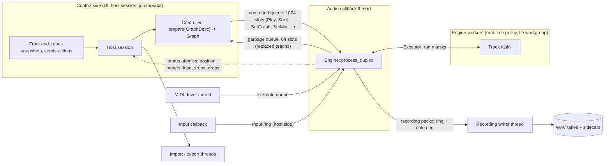
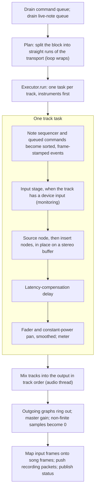

# EchLub DAW Engine: Architecture

EchLub's DAW engine is a Rust audio engine written for a native Mac DAW and
for later reuse on the web. Its audio-thread half never allocates, frees,
locks or waits, and its output is bit-identical across block sizes, between
offline and live rendering, and across worker-thread counts (within one build
on one platform). Every sound source and effect is a node behind a
plugin-shaped interface, so built-in modules and a future third-party plugin
adapter take the same path. This document explains the structure, the
interfaces and the invariants; the technically critical implementations
(synth lanes, worker scheduling, latency-compensation and crossfade
mechanics, the session and collaboration layers) are described by what they
guarantee and how that is tested, not by how they work. How each claim is
proven is in [daw-evidence.md](daw-evidence.md); how the code is divided into
crates is in [daw-module-map.md](daw-module-map.md).

> **Reading this outside the private workspace.** This document comes from the
> EchLub DAW workspace; the public repository holds only a subset of it
> (`echlub-rt-testkit`, `echlub-rt-thread`, `echlub-audiofile`, `echlub-node`,
> `echlub-dsp`). Paths such as `crates/echlub-engine/...`, `crates/echlub-synth/...`,
> `crates/echlub-desktop-host/...`, `apps/desktop/...`, `docs/ai/...` and
> `scripts/...` name code and notes that are **not in this repository**, so the
> tests and benches cited from there cannot be run from here. "Decision N",
> "the work log" and the short commit hashes refer to the author's private
> design log and git history.

Scope of this document: the code as it stood when the document was last
revised, and the decisions in the author's private design log (cited below as
"decision N").
Three kinds of statement are kept apart throughout:

- **Measured**: a test or bench produced the number, under stated conditions.
- **Simulated input only**: the code ran against a simulated device,
  simulated input or simulated MIDI, not real hardware.
- **Not verified by a person**: nobody has listened to the output, and the
  interactive paths of the app (dialogs, shortcuts, mouse seek, loop drag,
  zoom, faders) have not been hand-driven.

## 1. Goals and constraints

| Goal | What it means in the code | Source |
| --- | --- | --- |
| Real-time safety | `Engine::process` never allocates, frees, locks or waits. All allocation happens on the control thread when a graph is prepared. | Module rules in the module map |
| Determinism within a build | The same events give the same samples for any block size, offline or live, any number of worker threads. Native and wasm need not match sample for sample. | Decision 3 |
| Platform-neutral core | `echlub-dsp` and `echlub-engine` have no UI, device, clock or file-system dependency in their real-time path and are meant to build for `wasm32-unknown-unknown`. A host (CoreAudio through cpal today, an AudioWorklet later) calls `process` from its callback. | Decisions 2, 5 |
| Plugin-shaped nodes | Sources and effects implement one interface modelled on CLAP (prepare, process with sample-accurate events, latency, tail, parameters, state). A later AU or CLAP adapter, even out of process, needs no engine change. | Decisions 12, 16 |
| Engine knows no song | The engine knows tracks, clips, notes and a tempo. A host turns its own document into a `GraphDesc`. | Module rules in the module map |
| Professional use | A person who works in a commercial DAW should be able to pick the app up. | Decision 8 |

Third-party plugin hosting (AU first, then CLAP, then VST3, out of process) is
planned (decision 16) and not built. Built-in effects are the shared language
of a shared song because they are deterministic on every machine.

## 2. Two halves, two queues

`engine(cfg)` returns two objects that share nothing except lock-free queues
and a block of atomics.

- **`Engine`** lives on the audio thread. `Engine::process` (and
  `process_duplex`, which also takes the block's device input) fills one block
  of interleaved stereo.
- **`Controller`** lives on the control thread. It prepares graphs (all
  allocation happens here), sends commands, reads the status atomics, and
  frees the graphs the engine hands back.



**Command queue.** A single-producer, single-consumer ring (`rtrb`) of
`Command` values. The engine drains it at the start of every block. A command
takes effect at the start of the block in which it is drained, and
parameter changes reach a node as sample-accurate events.

| Command | Effect |
| --- | --- |
| `Play`, `Pause`, `Seek(frame)`, `SetLoop(range)` | Transport. Positions are song frames. |
| `SetClick(bool)`, `SetMasterDb(db)` | Metronome and master gain (between graphs: each graph brings its own `master_db`, section 3). |
| `SetMix { track, mix }` | Gain, pan, mute, solo, smoothed. |
| `SetParam { track, node, id, value }` | A node parameter, delivered as an event. |
| `SetGraph(graph)` | Swap in a prepared graph without a break (section 3). |
| `Panic` | Stop the transport and cut every sound. The only hard cut. |
| `SetInputLatency(frames)`, `SetRecord(spec)`, `Live(note)` | Recording and live-note control (section 10). |

**Garbage queue.** The audio thread never frees. A replaced graph goes back
through a second ring to the control thread, which frees it. If that ring were
ever full, the engine leaks the graph rather than free it on the audio thread.

**Status.** Position, playing flag, per-track and master meters, load, xruns,
dropped-event counters and recording counters are atomics the control thread
reads without locks. Meters cover the first 128 tracks; more tracks still play.

## 3. Prepared graphs and swaps

A host describes what to play as a `GraphDesc`: tracks in order, a tempo, a
beats-per-bar value. Each `TrackDesc` has a stable `id`, a `Source`, an ordered
list of insert effects, an optional device input, and gain, pan, mute and solo.

```rust
pub enum Source {
    Clips(Vec<Clip>),                                          // audio: recordings, imports, frozen instruments
    Synth { notes: Vec<NoteEvent>, params: SynthParams },      // the built-in synth
    Instrument { notes: Vec<NoteEvent>, node: Arc<dyn NodeFactory> }, // any instrument node
}
```

The description also carries the master fader (`master_db`, since
2026-11-20): at a swap the master level glides to it, and the first graph an
engine receives sets it at once, so an offline render at X dB equals a live
render at X dB bit for bit. At exactly 0 dB the level is exactly 1.0 (the
multiply the engine always did), so graphs at 0 dB render the same bits as
before. An automated master fader is its lane's level, as a track's; the
stored fader is then not applied.

`Controller::prepare(desc)` builds a `Graph` on the control thread: it creates
nodes through their factories, calls `Node::prepare` so each takes all its
memory for the largest block, and allocates every buffer. The result is sent
with `SetGraph`. Descriptions hold factories (cheap to clone and compare), so
a host can rebuild a whole description after every edit.

A swap keeps the sound going. Tracks are matched by `id`: a matched track
keeps its voices, clip playback and fader position; nodes with identical
settings are moved into the new graph whole; the rest of the old graph
releases and rings out as an *outgoing* graph (up to four may sound at once,
and a swap while four are already busy cuts the oldest). Graphs must be sent in
the order they were prepared, or matching is skipped; the engine still
releases and fades, never cuts. The swap is covered by the continuity tests
(section 8) and by the no-allocation test, which swaps while playing and while
stopped.

## 4. Transport and the clock

What the code does:

- The transport position is a song frame (`u64`). `Play`, `Pause`, `Seek` and
  a loop range (`SetLoop`) are commands. Per block the engine splits the block
  into straight runs wherever a loop wraps (up to 32 runs per planning pass).
- Tempo is a property of the graph. It drives the metronome and is delivered
  to nodes in the transport event for tempo-synced behaviour. The musical
  grid (ticks, bars) lives in the host's `timeline.rs`, which converts ticks to
  frames; the engine never sees ticks.
- The engine keeps a short history of transport changes. That history lets it
  report the position that is *audible* (latency compensated), and, while
  recording, place each input frame on the song frame the performer heard
  (section 10).

Decision 10 requires the clock to become replaceable (so a remote session can drive it)
and launches to be commands aimed at a bar and beat, so a local click and a
remote player's launch take the same path. That work belongs to the Session
engine, which is in progress and is deliberately not described here. No
network timing has been measured and no latency claim is made for it.

## 5. One block, end to end



Three points about this flow carry most of the design.

1. Tasks are independent: each touches only its own track, and mixing happens
   afterwards on the audio thread in track order. That is why any executor
   gives bit-identical output.
2. Everything that depends on time is keyed to frames, not to blocks: events
   carry a frame offset, parameter smoothing runs per sample, tail-silence
   checks happen on fixed engine-clock boundaries (`TAIL_CHUNK` = 256 frames).
   That is why the block size cannot change a sample.
3. A stopped track that is silent and whose nodes report `Sleep` becomes
   idle and costs nothing until the next event.

### Constant-gain paths in the mixing loops

The loops that scale audio by a smoothed level (`Smoothed`, one `tick` per
frame) have a second form for the common case, a level that has long
settled: one gain for the block, a plain loop over the frames that the
compiler can vectorise. A settled `Smoothed::tick` (`diff == 0.0`) returns
exactly `target` and leaves its state as it was, so the block's samples are
the same bits; `Smoothed::hold` checks that and normalises the state in
one call, and returns the one value. Where the per-frame loop multiplies in
an order the constant form could change, the order is kept
(`sample * gain * pan`, never `sample * (gain * pan)`).

| Loop | Level | Constant form when | Can its target change inside a block? |
|---|---|---|---|
| mute/solo tap (`audible`) | `Track::audible` | settled | No: set by `retarget` (commands, graph swaps) between blocks |
| fader and pan | `gain`, `pan_l`, `pan_r` | all three settled; a gain or pan lane holds one value (the same bits) over the block | No: `retarget` and swaps only; lane values are filled before the block's mix |
| sends, `feed_sends` and `feed_sends_grouped` | `SendSlot::level` | settled; a send lane holds one value over the block (converted once with `db_to_gain`, a pure function) | No: `set_send` (command) and swaps only |
| master fader | `Engine::master` | settled; the master lane holds one value over the block | No: `SetMasterDb` and swaps only |

Group tracks run the same fader code as tracks and their sends the same
send code. The condition is checked per block, per loop; a glide still in
motion, a lane with a point inside the block, or an empty block takes the
per-frame loop exactly as before, so a level that settles or is moved
between blocks changes path with no change in bits. Anything the loop
computes besides audio (meter peaks, the `any` / `bus_active` flags that
decide whether a return is fed, silence) is computed from the same
products in the same order. No target of any of these levels changes
inside a block: block-exact commands apply before the block, and the
sample-accurate events (`SetParamAt`) address node parameters, not these
levels. The conversion from dB stays `db_to_gain` (not `math::from_db`).

Proof: the crate's own unit test `mixcheck` runs randomised graphs
(plain, grouped and nested, pre and post sends, flat, stepping and moving
lanes, fader, pan, send and master moves between blocks, mute and solo,
swaps, pauses and seeks, clips with `-0.0`, denormals, infinities and
NaN) at block sizes 1, 17, 64, 128, 256, 512 and 1 to 8 threads, through
the engine as built and through a copy whose loops are forced onto the
per-frame form (a flag read once when a track or the engine is made,
compiled only into that crate's tests), and compares every output sample
and every meter bit for bit; it also checks that each loop was taken both
ways. `tests/mix_paths.rs` runs the same shapes under the no-allocation
counters. `examples/bench_sends.rs` measures the cost.

### Automation fill: a flat stretch is one run

`Live::fill` (`automation.rs`) writes an engine level's values for a block
(fader, pan, send and master lanes) one piece of the lane at a time. A piece
whose frames all have one value is written as a run, with no per-frame
evaluation:

- a hold, outside the 384-frame smootherstep into it (before the first
  point, after the last, inside a hold segment);
- a stopped run (the level stays at `last`);
- a ramp whose two ends have the same value: `a + (b - a) * t` with `b - a`
  a zero is `a + 0` for every `t` (always positive and finite), one bit
  pattern for every frame, and it is evaluated once with the same
  expression (so `-0.0` ends give the one `+0.0` the loop gives).

A step into a hold, a ramp that moves, and every piece with a blend running
are evaluated frame by frame as before. A block that holds a point, a
segment boundary, a tempo change, a loop wrap or a seek is several pieces
(or runs): each is a run or a frame loop by the same rule, so a block that
crosses a point is evaluated as it was exactly where the lane moves.

The level goes through the delay ring (`push`: blend, write, read `delay`
frames back). A run is the same as `count` pushes of `v` only when the blend
is over and the ring holds nothing but `v`: then each push writes `v` over
`v` and reads `v`. The lane tracks that (`run_bits`, `run_len`: the bits of
the last value written and how many writes in a row, the ring being full of
it at `ring.len()`; a ring filled or copied at `prepare_level`,
`enter_level` or `take_level` carries its own). Until then `push_run` pushes
frame by frame, so the first `delay + 1` frames after a change, and the 384
of a blend, take the old path. Consumers are unchanged: the fader, send and
master loops still ask `flat(&vals[..n])` for their constant-gain form.

Proof: the unit test `runs_equal_the_per_frame_values_bit_for_bit` runs
random lanes (every shape, points on and off block and 64-frame boundaries,
tempo changes, ticks and seconds, both zeros and equal values, delays 0 to
300, loop wraps, seeks, stops, swaps with their blends) at block sizes 1,
17, 64, 128, 256 and 512, with a test-only switch (`automation::reference`,
read when a lane is made) that evaluates every frame, and compares every
value and the `last` it keeps bit for bit; `a_ramp_between_equal_ends_has_one_bit_pattern`
checks the claim above for every pair of equal ends of a set including both
zeros and denormals. In `mixcheck`, `the_fills_runs_equal_per_frame_evaluation_through_the_engine`
plays whole engines (lanes of the same kinds on faders, pans, sends and the
master, tempo steps, seeks, pauses, swaps, 1 to 8 threads) three ways, as
built, with only the fill per-frame (the consumers still take their
constant-gain paths), and with the fill and every mixing loop per-frame, and
compares every output sample and meter. Nothing allocates: `vals` and the
ring are sized at `prepare_level`.

## 6. The node interface

`crates/echlub-node/src/lib.rs` (the engine re-exports it as `echlub_engine::node`). This is the plugin-shaped boundary. The
condensed contract:

```rust
pub trait Node: Send {
    fn info(&self) -> NodeInfo;                    // latency, tail, deterministic
    fn params(&self) -> &[ParamInfo];              // id, name, min, max, default
    fn prepare(&mut self, sample_rate: u32, max_block: usize);          // control thread: take all memory
    fn process(&mut self, left: &mut [f32], right: &mut [f32],
               events: &[NodeEvent]) -> Status;                         // audio thread, in place
    fn reset(&mut self);                           // hard cut (Panic)
    fn save_state(&self) -> Result<Vec<u8>, StateError>;                // control thread
    fn load_state(&mut self, bytes: &[u8]) -> Result<(), StateError>;
    fn take_over(&mut self, old: &mut dyn Node, t: &TransportInfo) -> bool; // continue across a graph swap
    fn busy(&self) -> bool;                        // still sounding after being replaced
    fn retired(&mut self) {}                       // a swap left this instance behind (default: nothing)
}

pub trait NodeFactory: Send + Sync + std::fmt::Debug {
    fn create(&self) -> Box<dyn Node>;
    fn same(&self, other: &dyn NodeFactory) -> bool; // identical kind and settings: instance moves across a swap
}

pub enum EventKind {
    NoteOn { pitch: u8, vel: f32 }, NoteOff { pitch: u8 }, AllNotesOff,
    Param { id: u32, value: f32 }, Transport(TransportInfo),
}
// NodeEvent { frame: u32, kind } is sorted by frame; every frame is below the block length.
```

The rules that matter:

| Rule | Why |
| --- | --- |
| `prepare` runs on the control thread and takes all memory for blocks up to `max_block`. | `process` can then be allocation-free. |
| `process` receives a sample-accurate, sorted event list. No polling for parameters. | Block size cannot change where an event lands. |
| `process` may not allocate, free, lock or block, but *may be slow*: the engine assumes no bound. | A future plugin, possibly out of process, may be slow. The deadline belongs in that node's adapter, not in the engine. |
| `info()` is fixed from `prepare` on. A node whose latency changes is rebuilt in a new graph. | The same restart rule CLAP uses. It keeps latency compensation simple. |
| `Tail`: `None`, `Frames(n)` or `UntilSilent`; `process` returns `Continue` or `Sleep`. | The engine keeps calling a node after the transport stops until it sleeps and its output is silent. |
| `deterministic: bool` | The bit-exactness tests cover only graphs whose nodes all say true. A third-party plugin adapter would say false. |
| `reset` is the hard cut; `AllNotesOff` is the soft release. | Stop, seek and loop end use the soft path. |

How a third-party plugin would fit (designed in `node.rs`, not built): an AU
or CLAP adapter is one more `NodeFactory` plus `Node` that owns the plugin
instance and maps `prepare`, `process`, `info` and the state calls onto the
plugin's own. An out-of-process sandbox is the same shape, with `process`
exchanging the block through shared memory and waiting with a deadline; on a
miss it outputs silence for the block and reports it, so a slow plugin is
flagged and never stops the sound (decision 16).

## 7. Built-in nodes

| Node | Where | Role |
| --- | --- | --- |
| Synth | `echlub-builtin-nodes` (wraps `echlub-synth`) | Instrument. Deterministic. Reports 2 frames of latency. |
| Sampler | `echlub-builtin-nodes` (wraps `echlub-sampler`) | Instrument: a drum kit (or, later, multisampled instruments as pads with note ranges). Deterministic. Latency 0. Parameter events glide gain and pan; a new kit is a new graph, whose sampler takes over the old one's voices when the samples are the same. |
| Effects | `echlub-builtin-nodes/src/effects.rs` (wraps `echlub-effects`) | Inserts: delay, saturation, compressor, limiter, reverb, EQ, ducker (sidechain) and utility. Deterministic. Each reports its own latency and tail. May carry a signal tap (the `tap` module of `echlub-node`). |
| Clip player | `echlub-builtin-nodes` | Plays audio clips with edge fades and transport crossfades (section 8). Deterministic. |
| Metronome | `echlub-engine/src/metronome.rs` | Click on the graph's tempo, driven by the `SetClick` command. |
| Latency probe | `echlub-builtin-nodes` | An insert that delays by N frames and reports exactly N: a stand-in for look-ahead effects and the device the latency tests use. |
| Input node | `echlub-builtin-nodes/src/input.rs` | Plugin-shaped stage in front of a track's chain that passes the device input for monitoring, so the monitored signal takes the track's inserts, latency compensation and fader like any source. |

DSP building blocks in `echlub-dsp`: decibel conversion, constant-power pan,
an exact-settling one-pole glide (`Smoothed`), a cubic resampler (used on
import, off the audio thread), our FFT and the portable math functions. The
synth is its own crate (`echlub-synth`).

**The synth in outline.** A virtual-analog polyphonic synth: three
oscillators with unison and hard sync, noise, state-variable and 4-pole ladder
filters, three curved envelopes, two LFOs, an eight-slot modulation matrix,
poly, mono and legato play with glide, and six factory presets. Oscillators are
band-limited. Guarantees, each covered by
tests described in [daw-evidence.md](daw-evidence.md): output is a pure function of the
calls made (seeded noise, no clock, no threads) and independent of how a host
slices `render_add` calls; nothing allocates after construction; no output is
non-finite under randomized extreme parameters; voice stealing, retriggering
and parameter jumps stay below the click limit; no filter or decimator state
goes subnormal. Nobody has listened to it.

Since 2026-11-20 an oscillator's wave has a fifth choice, Wavetable: a list of
single cycles read at a position (`oscN.wt_pos`, a modulation destination),
from band-limited levels with a 4 ms crossfade between levels. A table is
built in, or made from a recording off the audio thread (`table_maker`), and
is a file in the project (`.ecwt`) shared by content hash under a memory
budget; a table made from a recording carries the maker's analysis trace in
its file (optional; see the design note's section 5). A patch without a wavetable is bit-identical to before. The design and its measurements are in the author's design notes (not in this repository).

**The sampler in outline** (`echlub-sampler`, decision 23). Kits of up to 32
pads; per pad a note or note range, up to 4 velocity layers (switched or
crossfaded) of up to 4 round-robin alternates, gain, pan, tune, start, an
attack / hold / decay envelope, one-shot or gated play, choke groups,
velocity to level, low-pass and start. 64 voices plus 16 slots where stolen
or choked voices fade over 5 ms. Resampling is a 64-tap Kaiser-windowed sinc (32 taps until 2026-11-20),
stretched when pitching up so nothing folds back; a file at the engine's rate
played untuned is copied bit for bit. Round robin restarts at each play start
or jump, and random mode hashes the song frame, so a render does not depend
on where playback began. Samples are decoded off the audio thread and shared
as `Arc<SampleData>`; the kit holds paths and BLAKE3 content hashes, never
audio, and a missing or changed file is a typed error and a silent pad.
Tests: no allocation after construction (with a positive control),
block-size identity, chokes and steals under the click limit, resampling
THD+N and aliasing (figures in the crate's README). Nobody has listened to it
with a real sample library.

## 8. Latency compensation and transport continuity

### Latency compensation (what, not how)

Nodes report their latency. A track's latency is the sum over its chain. The
graph's latency is the largest track latency, and every track is delayed so
that musical frame *m* of every track reaches the output at the same moment.
Consequences the engine guarantees and tests:

- Tracks with different latencies line up on the musical frame.
- The reported position is the audible one, `L` frames behind what is being
  rendered.
- `render_offline` renders ahead and drops the first `L` frames, so frame *N*
  of an offline render is musical frame *N*.
- A graph swap that changes `L` does not click.
- Recorded input is placed on the frame the performer heard: device round
  trip plus graph latency.

Sends (returns) and group tracks (buses) align at every merge point, each
consumer padding to its own destination:
user tracks align to `A` (the largest user or click latency); a group's
input waits for its latest member (`I = max` of their output times) and
its output is at `I + G` (its chain); the returns' input is at
`S = max(A, the output times of groups that send)`, a source earlier than
`S` delaying its send taps; the master's input is at
`B = max(S + Rmax, top-level group outputs, A)`; the graph's latency is
`B + M` (the master chain). Without groups `S = A` and `B = A + Rmax`, so
every delay is what it was. Impulse tests through chains of known latency,
nested groups included, land every path on one frame
(`echlub-engine/tests/groups.rs`). A group's pan is a balance (unity at
the centre), not the tracks' pan law, so a group at 0 dB and centre
passes its members through unchanged.

### Transport continuity

| Moment | Guarantee |
| --- | --- |
| Stop | Notes are released, not cut. Tails keep rendering until every node reports `Sleep` and a whole 256-frame chunk was silent; then the track idles. Clips fade out. |
| Loop wrap | Held notes get their note-off on the exact loop-end frame and the new position's held notes are chased. Clips cross-fade. |
| Seek while playing | Same as a loop wrap: release, chase, cross-fade. |
| Graph swap | Matched tracks continue (section 3); unmatched ones release and ring out. |
| Clip edges | Every clip edge has a short fade, applied in place so nothing moves in time. A clip that starts at its file's first frame keeps its attack (a design decision, 2026-11-17); trimmed starts and all ends are faded. |
| `Panic` | The only hard cut. It also stops the transport and keeps the position. |

The transport crossfade is 5 ms (`XFADE_MS`) and the clip-edge fade is 3 ms
(`EDGE_MS`); both are public constants. The equal-power crossfade and "ghost"
reader that implement the clip behaviour are not described here. The tests
measure the result with the click metric described in
[daw-evidence.md](daw-evidence.md): every continuous case measured between
1.4e-5 and 4.5e-5 against a limit of 1.5e-4, while the same moments done as a
hard cut measured 0.6 to 0.66 (release build, Apple M4 Max).

## 9. Multicore and the macOS real-time host

### The executor abstraction

The engine runs its per-track work through a trait the host supplies:

```rust
pub trait Executor: Send {
    /// Run task(i) exactly once for every i in 0..n, possibly on several threads at once,
    /// and return when all have finished. Called on the audio thread: no allocation,
    /// no locks, no blocking beyond waiting for tasks it handed out.
    fn run(&mut self, n: usize, task: &(dyn Fn(usize) + Sync));
    fn threads(&self) -> usize { 1 }
}
```

`Serial` (the default, and what wasm uses) runs every task on the calling
thread. `pool::Pool` (native only) runs them on pre-spawned worker threads
while the audio thread works on them too. Track output is mixed afterwards in
track order, so any executor gives the same samples.

What the pool guarantees: no allocation on the audio thread or the workers
(counted, with workers watched for their whole life); the audio thread does
not wait for a sleeping worker to wake; the only wait on the audio thread is
for tasks other threads already took, bounded by the longest single task *if
that worker is not preempted*; output is bit-identical for any worker count.
That last conditional is why the host puts workers under a real-time policy.
The pool also does not assume a node finishes within any bound: it waits for
every task it handed out, and a deadline for an untrusted node belongs in that
node's adapter. The claiming and parking mechanism is not described here.

### The macOS host (`echlub-rt-thread`, `crates/echlub-desktop-host/src/rt.rs`)

Each worker thread is made fit for audio in three steps, each of which fails
safe:

1. **Real-time policy.** `thread_policy_set` with `THREAD_TIME_CONSTRAINT_POLICY`
   for the buffer period: the computation budget is half the period, the
   constraint is the whole period, preemptible (Apple's guidance for audio
   worker threads).
2. **Find the output device's IO workgroup.** CoreAudio
   `AudioObjectGetPropertyData` on the default output device with
   `kAudioDevicePropertyIOThreadOSWorkgroup` (`oswg`), macOS 11 or later.
3. **Join it.** `os_workgroup_join` from each worker (and `os_workgroup_leave`
   when the worker exits), so the OS schedules the workers together with the
   CoreAudio IO thread on performance cores and knows they share its deadline.
   `os_workgroup_max_parallel_threads` gives the workgroup's own advice on
   parallelism.

If any step fails (older macOS, no device, an OS refusal), the worker still
runs, unjoined, and a `WorkerReport` says how many workers got the policy and
how many joined. Non-macOS builds compile to stubs that report "no workgroup".
For benches that stand in for the device, `AudioWorkIntervalCreate` (macOS 12
or later) makes a work interval of the bench's own, started and finished every
block with a one-period deadline.

The worker count is one fewer than the machine's performance cores, capped at
7. Workers spin 50 microseconds after their last task and then park; the
spin is short on purpose, because a time-constraint thread that keeps the CPU
beyond its declared computation is demoted by the scheduler (measured in a
bench: a thread that spun between blocks ran 4x slower).

Results (measured, Apple M4 Max, release, 128-frame blocks at 48 kHz paced in
real time, best of 3, load average about 3 to 4 from other work): the mean
share of the block budget for 64 audio tracks plus 16 Pad tracks of 8 voices
falls from 24.5% on one thread to 6.2% on eight; 32 Bass tracks of 8 voices
from 27.0% to 6.4% (12 threads); 32 Keys tracks of 8 voices from 24.0% to 5.9%
(6 threads). Scaling flattens around 6 to 8 threads. The app's self-test
reported 7 of 7 workers under the real-time policy and 7 of 7 joined to the
device workgroup. Without a workgroup the same pool was bimodal, with worst
blocks of 100% to 300% of the budget. Full table in
[daw-evidence.md](daw-evidence.md).

## 10. The recording path

Recording spans the audio thread, an input callback, a MIDI thread and a
writer thread. Nothing on the audio side allocates, locks or performs I/O.

```text
 input device                                     output device
      |                                                 ^
      v                                                 |
 input callback --push--> [input ring] --pull--> output callback
 (timestamped)                                    |  DuplexCore: one block of input per block of output
                                                  |  Engine::process_duplex
 MIDI driver thread --[live-note queue]-----------+     - monitoring (input stage in the track chain)
 (host time stamp + fixed offset)                 |     - place each input frame on the song frame heard
                                                  |     - push fixed-size packets of armed tracks
                                                  v
                                          [recording packet ring] ----> writer thread
                                                                         - one crash-safe WAV per take
 Also written by the output callback:                                    - JSON sidecar (song position)
   [note report ring]    live notes with the song frame heard            - fsync checkpoint every 1 s
   [always-on capture]   preallocated in-memory ring, last 5 minutes
 (both are read by the host session on the control side)
```

- **Duplex.** cpal opens input and output as separate streams, so input
  samples cross to the output callback through a lock-free ring. On one device
  (one clock) the fill level is held constant and input is sample-locked to
  output. Across two devices the clocks drift; the core bounds the fill by
  dropping input frames or filling silence, counts every slip, and the app
  shows a warning. There is no software drift resampling: macOS offers drift
  correction in an Aggregate Device, and the app points the user there.
- **Placement.** The engine keeps the transport history (every play, stop,
  seek, loop wrap and record change). An input frame consumed at engine clock
  `k` was played against the song frame rendered at `k - (input latency +
  graph latency)`, where input latency is the device round trip measured from
  device timestamps or by loopback calibration. Each straight run of the
  transport while recording gets its own take serial, so a loop pass is a new
  take and a punch records only its range.
- **Packets and loss.** The audio thread pushes fixed packets of 128 frames
  into a preallocated ring. If the ring is full the packet is dropped and
  counted (packets and frames), never silently; the writer fills the gap with
  silence so the rest of the take stays on its frame.
- **Writer.** A plain thread drains the ring into one 32-bit-float WAV per take
  with a sidecar saying where it sits in the song. Guarantees of the WAV
  writer: the header sizes are rewritten and `fsync`ed at every checkpoint
  (1 s), so after a crash the file is a valid WAV of everything up to the last
  checkpoint; `repair` recovers every whole frame that reached the disk and
  cuts a torn last frame; repairing an intact file changes nothing; it refuses
  files it did not write; it refuses to exceed the 4 GiB limit of plain RIFF
  (about 3.1 hours of 48 kHz stereo float) rather than write a broken header.
  A sidecar marks a take unfinished until it is closed, so recovery on open
  knows which files a crash left behind.
- **Calibration.** A burst of noise is played and recorded back; an FFT
  cross-correlation finds the round trip to a fraction of a frame; a result
  whose peak does not stand clear of the rest is refused. Results are stored
  per device and rate.
- **MIDI.** A note stamped at host time `T` is scheduled on engine clock
  `clock_at(T) + offset`, where the offset (one buffer plus a margin) makes
  sure it arrives before its block renders. Jitter in delivery becomes a fixed
  latency. A note that still arrives late plays on the block's first frame and
  is counted.
- **Always-on capture.** MIDI by default, audio opt-in, the last 5 minutes in
  memory only, nothing written to disk unless the user keeps it (decision 13).

Status: all evidence for this path is **simulated input only** (simulated
devices and MIDI). No real microphone, real loopback calibration, real MIDI
hardware or two real devices have been measured.
