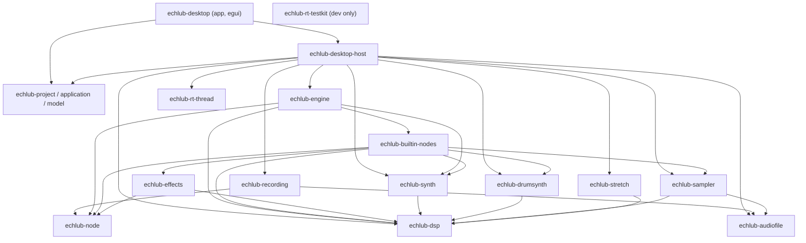

# EchLub DAW: Module Map

The DAW is a set of small crates with one job each and dependencies that only
point downward, checked from `cargo metadata` by
`scripts/check-daw-architecture.py` (a script of the private workspace; the
split was made on 2026-11-17). Section 1
describes the code as it is. Section 2 compares it with the plan this map
used to carry and says where and why it differs. The engine's design is in
[daw-engine.md](daw-engine.md) and how its claims are tested is in
[daw-evidence.md](daw-evidence.md).

> **Reading this outside the private workspace.** This document comes from the
> EchLub DAW workspace; the public repository holds only a subset of it
> (`echlub-rt-testkit`, `echlub-rt-thread`, `echlub-audiofile`, `echlub-node`,
> `echlub-dsp`). Paths such as `crates/echlub-engine/...`, `crates/echlub-synth/...`,
> `crates/echlub-desktop-host/...`, `apps/desktop/...`, `docs/ai/...` and
> `scripts/...` name code and notes that are **not in this repository**, so the
> tests and benches cited from there cannot be run from here. "Decision N",
> "the work log" and the short commit hashes refer to the author's private
> design log and git history.

## 1. The crates

### 1.1 Crates and responsibilities

Layer 0 is the most basic. Every crate the DAW owns has a README that says
what it holds, what it may depend on and how to check it.

| Layer | Crate | Responsibility | Depends on (workspace) | Platform-neutral |
| --- | --- | --- | --- | --- |
| 0 | `echlub-rt-testkit` | Test helpers shared by the real-time tests: counting allocator with a positive control, click metric, bit-for-bit buffer comparison, block runner. Dev-dependency only. | None | yes |
| 0 | `echlub-node` | The node interface (`Node`, `NodeFactory`, events, parameters, latency) and the recording packet and ring types (`io`: `RecPacket`, `MidiRec`, `RecTap`, `rec_tap`), and the signal tap (`tap`: `TapPoint`, `TapReader`, `LevelRec`). | None (`rtrb`) | yes |
| 0 | `echlub-audiofile` | WAV (16/24/32-bit integer, 32-bit float) AIFF / AIFF-C and uncompressed CAF decode and WAV encode on plain buffers; the crash-safe streaming take writer and its repair. | None | yes |
| 0 | `echlub-dsp` | Decibels, constant-power pan, exact-settling glide, peak, cubic resampling, our FFT (`fft.rs`, moved here from `echlub-stretch` so the synth can use it) and the portable math the cross-platform identity needs (`math.rs`). | None (`libm`) | yes |
| 0 | `echlub-rt-thread` | macOS real-time threads: time-constraint policy, IO workgroup join, work intervals, performance-core count; no-op stubs elsewhere. | None (FFI) | no |
| 1 | `echlub-synth` | The virtual-analog synth, its parameter table and presets; the wavetable oscillator (`wavetable.rs`, a fifth choice of an oscillator's wave) and the maker of tables from recordings (`table_maker.rs`, off the audio thread). | `echlub-dsp` | yes |
| 1 | `echlub-drumsynth` | The drum synthesizer : twelve synthesized voices on the GM drum map (kick, snare and rim, clap, metal hats and cymbals with choke groups, toms), its parameter table and presets. No samples, no files. | `echlub-dsp` | yes |
| 1 | `echlub-sampler` | The sample instrument (decision 23): kits of up to 32 pads with velocity layers, round-robin alternates and choke groups, its parameter table, decoded samples (`SampleData`) and the resampling kernel. Kit descriptions hold paths and content hashes, never audio; it reads no files. | `echlub-audiofile`, `echlub-dsp` (`blake3`) | yes |
| 1 | `echlub-stretch` | Time-stretching and pitch-shifting of audio clips (decision 31): our FFT, the onset detector, time maps with a zone of slope 1 around each transient, and the PV+T renderer (rendered ahead on a worker; a render is a function of its source, map and settings). | `echlub-dsp` | yes |
| 1 | `echlub-recording` | After the audio thread's tap: the take writer thread, always-on capture, loopback calibration. | `echlub-node`, `echlub-audiofile` (`echlub-engine` for tests only) | no |
| 1 | `echlub-effects` | The built-in effects (decisions 22 and 23), eight kinds: delay, saturation, compressor, limiter, reverb, EQ, ducker (sidechain) and utility. Each has a parameter table, sample-accurate smoothed parameter events, state save and restore, and reports its latency and tail. It uses the node crate's event and transport types; no engine types. Measurements are in the crate's README. | `echlub-dsp`, `echlub-node` | yes |
| 2 | `echlub-builtin-nodes` | Synth, sampler, drum synth and effect adapters, audio-clip player and its continuity rules, device-input stage, latency probe. | `echlub-node`, `echlub-synth`, `echlub-sampler`, `echlub-drumsynth`, `echlub-effects`, `echlub-dsp` | yes |
| 3 | `echlub-engine` | `Engine` and `Controller`, the prepared graph, clock and tempo map, metronome, session launch on the audio side, ownership helpers, monitoring and the recording tap, the worker pool (native only), `render_offline`. Re-exports `node` and `nodes`. | `echlub-node`, `echlub-builtin-nodes`, `echlub-synth`, `echlub-dsp` | yes (the pool is not built for wasm32) |
| 8 | `echlub-desktop-host` | Everything the app does except draw: devices and streams, MIDI, the session, import/export, save/open, the snapshot, the recipe tool, the duplex core, mixer behaviour and the command router (`interaction`), the seed project (`fixture`), sampler tracks (`kit.rs`: the sample pool that reads, hashes and decodes files on a worker thread; `session_kit.rs`: kits, pad loads, undo). `facade` re-exports the few engine, synth and sampler items a front end needs. | `echlub-engine`, `echlub-recording`, `echlub-audiofile`, `echlub-rt-thread`, `echlub-synth`, `echlub-sampler`, `echlub-drumsynth`, `echlub-stretch`, `echlub-dsp`, the project crates | no |
| 9 | `echlub-desktop` (`apps/desktop`) | The egui front end and native shell; binaries `echlub-desktop` (default) and `echlub-project`. | `echlub-desktop-host`, `echlub-project`, `echlub-application`, `echlub-model` | no |
| 10 | `echlub-web-demo` (`apps/web-demo`) | The app in a browser page: the web entry (eframe `WebRunner`) over `echlub-desktop`, the page's demo song, the engine pump its AudioWorklet player is fed from; the host side is `Session::new_browser` and `clock.rs`. Only the song and pump modules build off wasm32. | `echlub-desktop`, `echlub-desktop-host` | no |

The project crates (`echlub-project`, `echlub-application`, `echlub-model`,
`echlub-kernel`) are earlier foundation work shared with other lines of the
monorepo. They are in the table at layers 0 to 2 so their edges are checked,
but they have no READMEs from this work. None of them depends on the engine.

Group tracks (buses, 2026-11-22) cross the layers without a new crate or
edge: `echlub-engine` runs them (`GraphDesc::groups`, `graph.rs`),
`echlub-project` stores them (`EffectsState::groups`, schema version 2 only
when there is one), `echlub-desktop-host` maps one onto the other
(`effects.rs`, `session_fx.rs`, the recipe's `groups`) and
`echlub-desktop` draws them (`panels/groups.rs`, the arrangement and the
mixer). Its design notes are not in this repository.

### 1.2 Dependency graph

Arrows point from a crate to what it depends on (normal dependencies only).
`echlub-rt-testkit` is a dev-dependency of the crates it tests and has no
runtime edges.

Sixteen crates are checked (the fourteen DAW crates and `echlub-project`,
`echlub-application`); the script reports 36 allowed edges (status
2026-11-20; the script's own table is the authority, and the graph above
leaves out the project crates' internal edges).

External crates: `rtrb` (node, engine); `libm` (dsp); `blake3` (sampler, project); `serde`, `serde_json` (recording,
host); `cpal`, `midir`, `objc2` (host); `eframe`, `egui`, `rfd`, `image`,
`objc2`, `raw-window-handle` (app).

### 1.3 What the checks enforce

`scripts/check-daw-architecture.py` (wired into `scripts/verify.py`) reads
`cargo metadata` and a table of the crates above. It fails when:

1. A crate in the table is missing or not where the table says.
2. A crate has a workspace dependency the table does not allow, or an allowed
   edge does not point to a lower layer (so the graph has no cycles).
3. A crate has an external dependency the table does not allow, or a
   platform-neutral crate has a target-specific dependency.
4. A dev-dependency is not allowed, or depends back on the crate it tests.
5. A workspace crate outside the table uses a DAW crate (only `echlub-song`
   may use `echlub-project`).
6. Text checks Cargo cannot see: `egui`, `eframe` or `rfd::` appear in the
   host or any crate below it; the app names a core or platform crate
   (`echlub_engine`, `echlub_synth`, ...) instead of going through the host;
   the host re-exports a lower crate anywhere but `src/facade.rs`.
7. A crate the DAW owns has no README.

`--neutral` prints the platform-neutral crates; `verify.py` builds them for
`wasm32-unknown-unknown`. `scripts/check-desktop-architecture.py` (also in
`verify.py` now) scans the app and the host for project-mutation helpers.
Each rule was checked once against a planted violation.

Kept by tests rather than the script: every crate that claims its audio path
does not allocate has a counting-allocator test with a positive control
(`echlub-dsp`, `echlub-synth`, `echlub-sampler`, `echlub-node`, `echlub-builtin-nodes`,
`echlub-engine`, `echlub-recording`, `echlub-desktop-host`). See
[daw-evidence.md](daw-evidence.md).

## 2. Proposed versus done

The plan this map carried before the split, and what happened to each part.

| Planned | Done | Notes |
| --- | --- | --- |
| `echlub-node` | Done | Also holds the recording packet and ring types (decision 3), so the engine and the recording crate both depend on it and not on each other. |
| `echlub-rt-testkit` | Done | Generic helpers only; engine-typed test helpers live in `echlub-engine/tests/common`. |
| `echlub-rt-thread` | Done | The pool, the device-workgroup lookup and the worker report stay in the host's `rt.rs`. |
| `echlub-audiofile` | Done | `wav` returns plain buffers plus a channel count; the host converts to `AudioData`. |
| `echlub-dsp` without the synth | Done | |
| `echlub-synth` | Done | No runtime dependency on `echlub-dsp` (it never used it outside tests). |
| `echlub-engine` (core) with built-in nodes | Changed | The built-in nodes became `echlub-builtin-nodes` (decision 1). The metronome stays in the engine because it counts the engine's tempo map. The worker pool stays in the engine (decision 2). |
| `echlub-session-launch` | Not made | The audio-side launch columns are woven into the graph's sequencer and the clip reader, and the control-side helpers must mirror them exactly; they are tested end to end through the engine. Splitting them would mean a crate that both depends on and is depended on by the engine. |
| `echlub-recording` depends on the engine | Changed | It depends on `echlub-node` and `echlub-audiofile` only (decision 3); the engine is a dev-dependency for its end-to-end tests. The duplex core stays in the host because it drives `Engine::process_duplex`. |
| `echlub-desktop-host` | Done | Also holds `interaction/` and `fixture.rs`, which the map put in the UI: the host session uses the mixer behaviour, the command router and the seed project, and they contain no UI types. |
| `echlub-effects` | Added after the split | Decision 22 moved the effects up. Built on an x86-64 Linux machine and re-run on the Mac at every stage. It sits beside the synth and sampler at layer 1; the node adapters are in `echlub-builtin-nodes`. Insert chains, sends and returns in the engine, the project model and the app are not built yet. |
| `echlub-sampler` | Added after the split | Decision 23 moved the sample instrument up. It sits beside the synth at layer 1; the node adapter is in `echlub-builtin-nodes`, file reading and the sample pool in the host. The engine knows it only as a dev-dependency (its tests). |
| `echlub-desktop-ui` | Done, under the old name | The package is still `echlub-desktop` so `cargo run -p echlub-desktop` and the `echlub-project` binary are unchanged. |
| Rule: one-way, acyclic | Enforced | Rule 2. |
| Rule: leaf crates stay leaves | Enforced | By the table (empty `deps`). |
| Rule: the core is platform-neutral and builds for wasm32 | Enforced | Rules 3 and 6, and the wasm32 step in `verify.py`. |
| Rule: the engine knows no project | Enforced | By the table. |
| Rule: no UI in the host | Enforced | By dependency (table) and by text (rule 6). |
| Rule: the UI reaches the engine only through the host | Enforced | Rule 6 and the table; the old `Monitor` / `TrackInput` leak goes through `facade`. |
| Rule: tiers do not leak | Not enforced | The tiers are not decided; nothing is published. |
| Rule: README, example and tests per crate | Partly | READMEs are enforced. Examples exist only where they did before (`echlub-engine`, `echlub-synth`, `echlub-desktop-host`); none were invented. |
